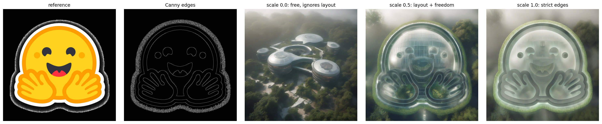
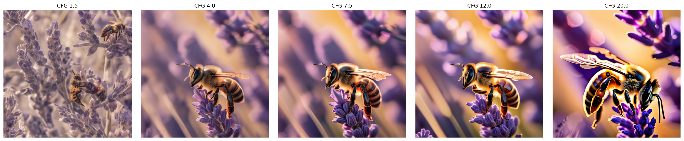
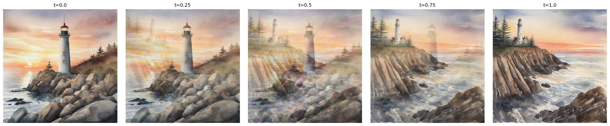
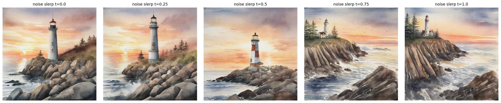

# Week 4: Text-to-Image & Latent Space Exploration

Lab 4 (`lab4.ipynb`, T4 GPU): SDXL base 1.0 with the fp16-fixed VAE; SDXL and the Canny ControlNet share one set of weights.

| Part | What | Result | Output |
|---|---|---|---|
| 1 | CFG sweep 1.5 / 4 / 7.5 / 12 / 20, seed 42 | Best looking at 4-7.5; CFG 20 oversaturated; CLIP vs CFG correlation about 0 | `lab4_images/cfg_sweep.png` |
| 1 | DPM-Solver vs DDIM, 20 steps | 18.4 s vs 19.0 s, same composition | `lab4_images/scheduler_compare.png` |
| 2 | ControlNet scale 0 / 0.5 / 1.0 | CLIP 0.359 -> 0.298 -> 0.252: structure up, prompt alignment down | `lab4_images/controlnet_comparison.png` |
| 3 | Linear latent interpolation vs noise slerp (seeds 0 and 99) | Linear t=0.5 is a double exposure; slerp is coherent at every step | `lab4_images/interp_linear.png`, `lab4_images/interp_slerp.png` |
| 4 | CLIP score for every image | | `lab4_images/clip_scores.csv` |

Homework: [`homework/`](homework/).
