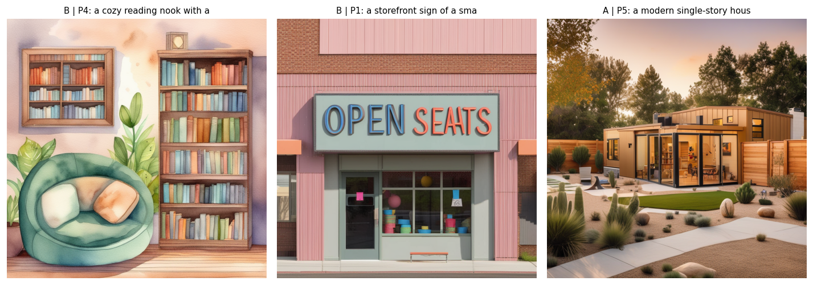

# Week 4 Homework: SDXL Pipeline, ControlNet & Evaluation

Theme linked to my capstone (child care for multilingual families): home daycare interiors, children's products and
outdoor play spaces.

## What I built

- **Part 1:** 15 SDXL images across 3 domains (interiors, product photography, outdoor). Each domain uses three prompt
  levels (abstract, specific, detailed-technical) with the same seed, and two schedulers (DPM++ 2M and Euler) compared
  with CLIP score.
- **Part 2 (use case A, e-commerce):** 5 children's products placed in kitchen, outdoor and studio scenes with Canny
  ControlNet (15 images), plus a conditioning-scale sweep (0.3, 0.5, 0.8, 1.0) measured with edge F1 (structure kept)
  and CLIP (scene followed).
- **Part 3:** 5 prompts x 3 configurations (SDXL, SDXL + ControlNet, OpenAI image API), scored with CLIP, LPIPS and a
  1-5 preference rating. Report in `report.md`.

## Files

| Path | Contents |
|---|---|
| `notebook.ipynb` | Full pipeline and outputs (T4 GPU) |
| `images/part1/`, `images/part2/`, `images/part3/` | All generated images, named by domain/product/prompt and setting |
| `images/tables/` | CLIP, edge F1 and LPIPS tables |
| `report.md` | Part 3 comparative evaluation report |
