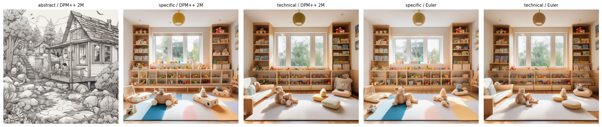
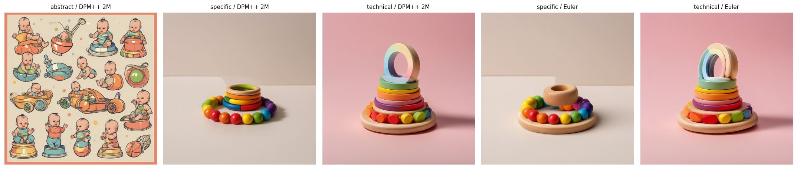
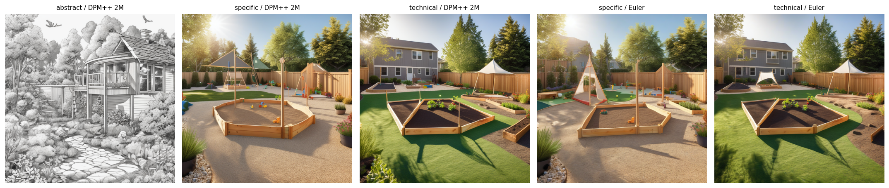
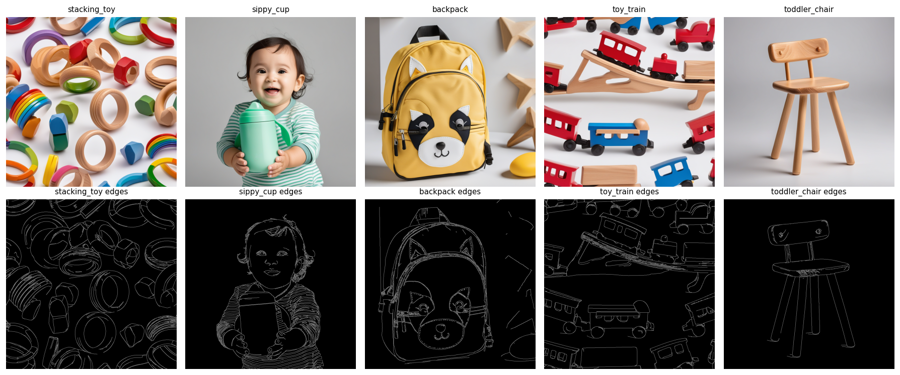
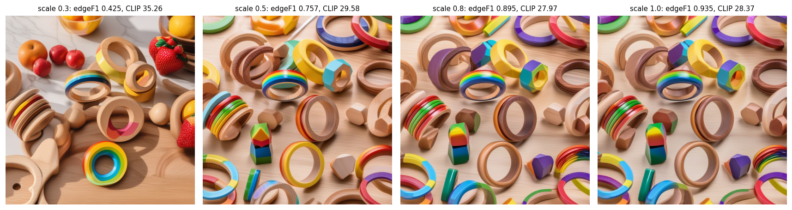
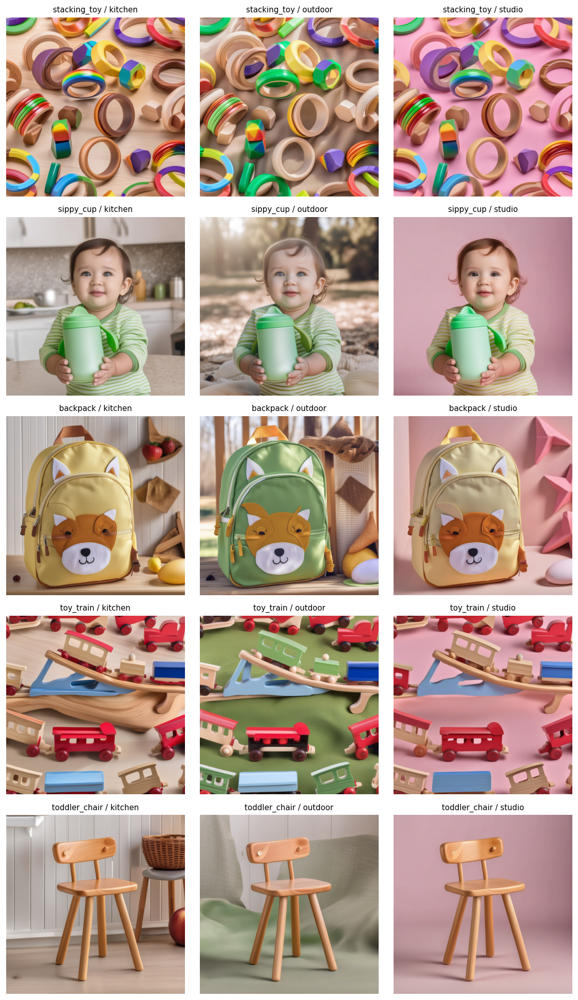

# Week 4 Homework: SDXL Pipeline, ControlNet & Evaluation

Theme linked to my capstone (child care for multilingual families): home daycare interiors, children's products and
outdoor play spaces.

*Best 3 images from Part 3: ControlNet reading nook, ControlNet "OPEN SEATS" sign (the only correctly spelled sign), SDXL house.*

## What I built

| Part | What | Output |
|---|---|---|
| 1 | 15 SDXL images: 3 domains x (3 prompt levels with DPM++ 2M + 2 with Euler), seed 42 | `images/part1/` |
| 2 | Use case A (e-commerce): 5 children's products x 3 lifestyle scenes with Canny ControlNet, plus a scale sweep | `images/part2/` |
| 3 | 5 prompts x 3 configurations, CLIP + LPIPS + rating | `images/part3/`, [`report.md`](report.md) |

All tables are in `images/tables/`. The notebook runs on a T4 with one shared SDXL + ControlNet pipeline (plain SDXL
images use ControlNet scale 0.0, which gives the base model's output) and skips images that already exist, so a crashed
session can resume.

## Part 1: Multi-domain text-to-image

**Prompt comparison** (CLIP x100 against one shared intent caption per domain, DPM++ 2M):

| Domain | Abstract | Specific | Detailed-technical | Best |
|---|---|---|---|---|
| Interior (daycare playroom) | 17.45 | **37.76** | 37.04 | specific |
| Product (stacking toy) | 21.61 | **37.60** | 34.98 | specific |
| Outdoor (play yard) | 23.07 | **32.60** | 29.58 | specific |

- **Abstract** prompts ("a cozy place where little kids play") failed in every domain: two became pencil sketches of a
  house, and "a fun toy for babies" became a sheet of baby cartoons, even though "people" was in the negative prompt.
- **Specific** prompts were best by CLIP in all three domains: they name the key objects without adding anything else.
- **Detailed-technical** prompts gave the most usable photos (correct lens look, shade sail, pastel product backdrop)
  but scored slightly lower because the extra terms (lens, f-stop, safety surface) dilute the main concepts, and in the
  product domain "6 pastel rings" produced a stacker with misplaced rings floating on top.

**Scheduler comparison** (same prompt and seed): DPM++ 2M and Euler produce the same composition with different
details (mean pixel difference 8.9-15.9 out of 255). CLIP differences were small and went both ways: mean absolute
difference 0.98 points, Euler higher in 4 of 6 pairs. Scheduler choice matters far less than prompt wording.

**Analysis (150 words).** The Week 3 lesson that specificity beats vagueness transfers directly: like a zero-shot text
prompt with no constraints, the abstract image prompts let the model fall back on its most common pattern (sketches,
cartoon babies). Naming the objects plays the role of a clear task description. Adding a role or style ("interior
architecture photograph, 24mm, f/8") works like a system prompt: it changes the register of the output. What does not
transfer is reasoning and structure. An image model cannot "think step by step", and it does not obey constraints such
as counts or negations reliably: the negative prompt "people" did not stop babies appearing, just as Part 3 could not
get "three apples and two pears". Long, detailed prompts also behave differently: in text, more context usually helps;
in CLIP-guided images, extra technical words compete for the 77-token text encoder and can lower alignment with the
main concept. Seed control replaces temperature as the way to make comparisons fair.

## Part 2: ControlNet for e-commerce (use case A)

The 5 reference "store photos" were generated with SDXL on a white background (no phone photos were added to
`products/`). Two references came out unsuitable: the stacking toy and the train were full-frame patterns of many
items, and the sippy-cup shot included a toddler holding the cup.

**Conditioning scale sweep** (stacking toy, kitchen scene):

| Scale | Edge F1 (structure kept) | CLIP (scene prompt) | Assessment |
|---|---|---|---|
| 0.3 | 0.425 | 35.26 | Real kitchen with fruit, but the product changed shape and colour |
| 0.5 | 0.757 | 29.58 | Product layout mostly kept; kitchen almost gone |
| 0.8 | 0.895 | 27.97 | Product layout kept; only the table surface changes |
| 1.0 | 0.935 | 28.37 | Near copy of the reference edges |

**Gallery** (scale 0.8, 15 images, mean edge F1 0.84):

**Memo (200 words).** I would deploy scale 0.8 for product catalogue images, with an input check. A buyer must receive
exactly the item in the photo, so shape fidelity comes first: at 0.8 the edge F1 was 0.85-0.95 for the backpack, the cup
and two of the three chair scenes while the scene still changed (kitchen counter, park blanket, pastel studio). At 0.3 the stacking rings changed
shape and colour, which would be false advertising. The sweep also shows the cost: CLIP for the scene fell from 35.3 to
28.0, because the edges, not the text, decide what fills the frame. That is where 0.8 fails. (1) Full-frame references:
the stacking toy and train references were patterns of many items, so their edges covered the whole canvas and no scale
above 0.5 left room for a kitchen. (2) References with people: the sippy-cup photo contained a toddler, and ControlNet
copied the child into all three scenes, which is not acceptable for a product listing. (3) Thin objects: the chair in
the kitchen scored edge F1 0.47 because background clutter added edges. So the pipeline needs a pre-step: remove the
background and centre the single product on blank space before extracting Canny edges, and reject reference photos that
contain people.

## Part 3

See [`report.md`](report.md): SDXL scored the highest CLIP, ControlNet got the best ratings (the only correct sign and
the only correct beanbag), and every configuration failed counting and left/right placement.
