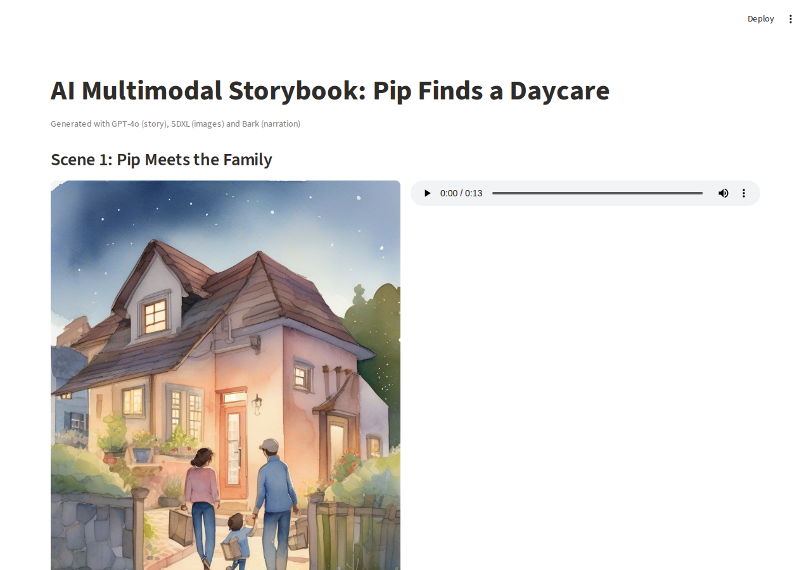

# Week 5: Multimodal Storytelling Pipeline

Story: *Pip the little robot helps a family that just moved find a friendly daycare for their baby.*



| Step | Model | Output |
|---|---|---|
| Narration for 3 scenes, with non-speech cues | Bark (suno-bark) | `scene1_audio.wav` ... `scene3_audio.wav`, `bark_audio_report.csv` |
| Scene illustrations, 768x1024 | SDXL base 1.0 | `scene1_image.png` ... `scene3_image.png`, `storyboard.png` |
| 3-scene story as JSON | GPT-4o (JSON mode) | `story.json` |
| Image vs narration alignment check | GPT-4o vision + Whisper | `alignment_report.csv` |
| Storybook app | Streamlit | `storybook_app.py` |

## Run the app

```bash
pip install streamlit
streamlit run storybook_app.py
```
The app reads the scene images, audio files and `story.json` from this folder.

The notebook is `lab5.ipynb` (T4 GPU); reflections are at the end of the notebook.
