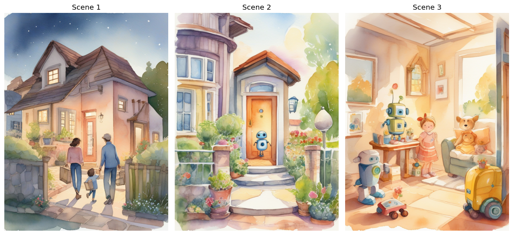

# Week 5: Multimodal Storytelling Pipeline

Story: *Pip the little robot helps a family that just moved find a friendly daycare for their baby.*




| Step | Model | Output |
|---|---|---|
| Narration for 3 scenes, with non-speech cues | Bark (suno-bark) | `scene1_audio.wav` ... `scene3_audio.wav` (13.4-14.6 s each) |
| Scene illustrations, 768x1024 | SDXL base 1.0 | `scene1_image.png` ... `scene3_image.png`, `storyboard.png` |
| 3-scene story as JSON | GPT-4o (JSON mode) | `story.json` |
| Cue check and image-narration alignment | Whisper + GPT-4o vision | `bark_audio_report.csv`, `alignment_report.csv` |
| Storybook app | Streamlit | `storybook_app.py`, `streamlit_screenshot.png` |

## Findings

- **Bark cues:** Whisper found none of the cue words in the audio, so no cue was read aloud as a word.
- **Speed:** Bark took 85-94 s per 13-15 s clip on a T4 (real-time factor about 6.4).
- **Image vs narration** (GPT-4o vision, 1-5): Scene 1 = 4, Scene 2 = 5, Scene 3 = 2. Scene 3's narration has a baby
  waving goodbye to the family, but the image shows a child alone with robots.
- **Cost for 500 lessons x 150 words:** about $135 with ElevenLabs, versus about 53 T4 GPU-hours (roughly $19) with Bark.

The full reflection is at the end of `lab5.ipynb`.

## Run the app

```bash
pip install streamlit
streamlit run storybook_app.py
```
The app reads the scene images, audio files and `story.json` from this folder.
